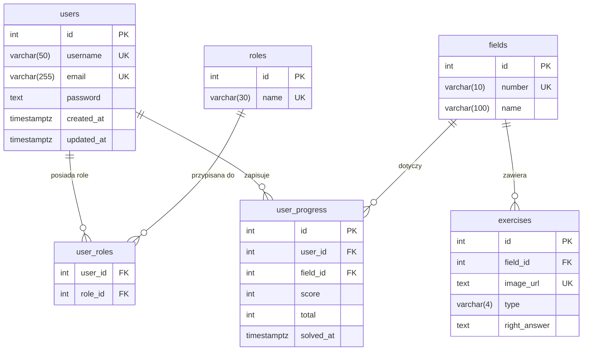

# ERD — Zdasz.to

## Diagram encji

## Tabele

### `users`
Konta użytkowników.

| Kolumna | Typ | Ograniczenia | Opis |
|---|---|---|---|
| `id` | `serial` | PK | Auto-increment |
| `username` | `varchar(50)` | UNIQUE, NOT NULL | Nazwa użytkownika |
| `email` | `varchar(255)` | UNIQUE, NOT NULL | Adres e-mail |
| `password` | `text` | NOT NULL | Hash bcrypt |
| `created_at` | `timestamptz` | NOT NULL, DEFAULT NOW() | Data rejestracji |
| `updated_at` | `timestamptz` | NOT NULL, DEFAULT NOW() | Data ostatniej modyfikacji |

---

### `roles`
Słownik ról (aktualnie tylko `ADMIN`).

| Kolumna | Typ | Ograniczenia | Opis |
|---|---|---|---|
| `id` | `serial` | PK | Auto-increment |
| `name` | `varchar(30)` | UNIQUE, NOT NULL | Nazwa roli |

---

### `user_roles`
Tabela łącząca — przypisanie ról do użytkowników (M:N).

| Kolumna | Typ | Ograniczenia | Opis |
|---|---|---|---|
| `user_id` | `int` | PK, FK → `users.id` CASCADE | Użytkownik |
| `role_id` | `int` | PK, FK → `roles.id` CASCADE | Rola |

---

### `fields`
Działy tematyczne CKE (np. `I – Liczby rzeczywiste`).  
Rekord z `number = '0'` to wewnętrzny dział "Mieszane" — niewidoczny w UI.

| Kolumna | Typ | Ograniczenia | Opis |
|---|---|---|---|
| `id` | `serial` | PK | Auto-increment |
| `number` | `varchar(10)` | UNIQUE, NOT NULL | Symbol działu (np. `V`) |
| `name` | `varchar(100)` | NOT NULL | Pełna nazwa działu |

---

### `exercises`
Pojedyncze zadania maturalne.

| Kolumna | Typ | Ograniczenia | Opis |
|---|---|---|---|
| `id` | `serial` | PK | Auto-increment |
| `field_id` | `int` | FK → `fields.id` CASCADE, NOT NULL | Dział zadania |
| `image_url` | `text` | UNIQUE | Ścieżka do grafiki (względna) |
| `type` | `varchar(4)` | NOT NULL, CHECK IN (`ABCD`, `PF`) | Typ pytania |
| `right_answer` | `text` | NOT NULL | CHECK: `[A-D]` dla ABCD lub `[PF]{2}` dla PF |

**Indeks:** `field_id`

---

### `user_progress`
Historia podejść do zestawów zadań.

| Kolumna | Typ | Ograniczenia | Opis |
|---|---|---|---|
| `id` | `serial` | PK | Auto-increment |
| `user_id` | `int` | FK → `users.id` CASCADE, NOT NULL | Użytkownik |
| `field_id` | `int` | FK → `fields.id` CASCADE, NOT NULL | Dział (lub `0` = losowy mix) |
| `score` | `int` | NOT NULL, CHECK ≥ 0 | Liczba poprawnych odpowiedzi |
| `total` | `int` | NOT NULL, CHECK > 0 | Łączna liczba zadań w sesji |
| `solved_at` | `timestamptz` | NOT NULL, DEFAULT NOW() | Czas zakończenia sesji |

**CHECK:** `score >= 0 AND total > 0 AND score <= total`  
**Indeks:** `(user_id, solved_at)`

---

## Widoki (Views)

| Widok | Opis |
|---|---|
| `v_exercise_catalog` | Zadania z dołączonymi danymi działu |
| `v_field_exercise_stats` | Liczba zadań ABCD / PF per dział |
| `v_user_progress_summary` | Zagregowane statystyki per użytkownik (łącznie z flagą `is_admin`) |
| `v_user_field_progress_summary` | Zagregowane statystyki per użytkownik × dział |
